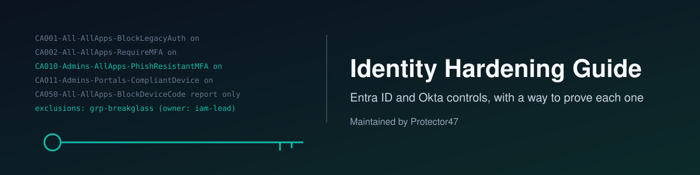

<p align="center">
  
</p>

# Identity Hardening Guide

[](https://github.com/Protector47/identity-hardening-guide/actions/workflows/ci.yml)
[](LICENSE)

Hardening notes for teams that own a workforce identity provider. Written for Microsoft Entra ID and Okta, with the parts that apply to any IdP marked as such.

Most cloud breaches I have reviewed did not need a cloud exploit. They needed a password and a missing MFA rule, a consented app nobody looked at, a long lived CI secret, or a Global Admin who also read email on the same account. This repo is the list of controls I check for that, why each one matters, and how to prove it is actually in place.

What you get:

- **51 controls** in a machine readable catalog ([controls/controls.yaml](controls/controls.yaml)), each with severity, platforms, and a concrete verify step.
- **Eight guides** that explain each control, with settings, policy tables, and the mistakes that break them.
- **KQL and Okta System Log references** to monitor your own tenant for drift.
- **Templates** for break glass, Conditional Access changes, app registration reviews, and a quarterly verification run.

It is for owners of the tenant. Nothing here tests or touches systems you do not control.

## Guides

| Guide | Covers |
| --- | --- |
| [01-tenant-baseline.md](docs/01-tenant-baseline.md) | Break glass accounts, tenant settings, guests, log retention |
| [02-authentication-and-mfa.md](docs/02-authentication-and-mfa.md) | Legacy auth, MFA for all, phishing resistant methods, registration and recovery, passwords, risk policies |
| [03-conditional-access.md](docs/03-conditional-access.md) | Policy register, baseline policy set with Okta mapping, report only, device trust, sessions, device code flow, exclusions |
| [04-privileged-access.md](docs/04-privileged-access.md) | Standing admins, admin accounts, PIM tiers, tier 0 infrastructure, PAWs, reviews |
| [05-applications-and-oauth.md](docs/05-applications-and-oauth.md) | Consent, high risk permissions, app inventory, credentials, redirect URIs, OAuth flows, SAML, token validation |
| [06-workload-identities.md](docs/06-workload-identities.md) | Managed identities, CI/CD federation with subject pinning, scope, monitoring, ownership |
| [07-lifecycle-and-reviews.md](docs/07-lifecycle-and-reviews.md) | HR driven JML, session revocation, movers, stale accounts, access reviews |
| [08-monitoring-and-verification.md](docs/08-monitoring-and-verification.md) | KQL and Okta event types for drift, quarterly verification |
| [control-index.md](docs/control-index.md) | Every control in one table, generated from the catalog |

## Where to start

If you only get through part of this, do it in this order. The first five close the paths I see used most.

1. Break glass accounts and alerting (IDH-BASE-01, IDH-BASE-02). Do this before touching any policy.
2. Block legacy authentication (IDH-MFA-01).
3. MFA for every interactive sign-in, no trusted network bypass (IDH-MFA-02).
4. Phishing resistant MFA for admins, separate cloud only admin accounts (IDH-MFA-03, IDH-PRIV-02).
5. Admin consent for high impact app permissions (IDH-APP-01).
6. Protect MFA registration and recovery (IDH-MFA-05).
7. PIM for everything except the short standing list (IDH-PRIV-01, IDH-PRIV-03).
8. Federated credentials for CI/CD, remove stored cloud keys (IDH-WL-02).
9. Revoke sessions in the leaver process (IDH-LC-02).
10. Alerts on policy, role, federation, and consent changes (IDH-MON-01 to IDH-MON-04).

## Using the catalog

The catalog is YAML so you can load it into a tracker, a GRC tool, or a spreadsheet.

```yaml
- id: IDH-WL-02
  title: Use workload identity federation for CI/CD, scoped to repository, branch, or environment
  severity: critical
  platforms: [entra, okta, generic]
  doc: docs/06-workload-identities.md
  verify: Federated credential subject is pinned to a specific repo and environment. No long lived cloud keys in CI secrets.
```

Run the checks locally:

```bash
pip install -r requirements.txt
python scripts/validate_controls.py
python scripts/build_index.py
```

`validate_controls.py` fails if a control is missing a field, an id is duplicated or out of sequence, a doc page does not mention its control, or a doc references a control that does not exist. CI also rebuilds the index and fails if the committed copy is stale.

## Scope and assumptions

- Entra ID guidance assumes P1 at least. P2 features (PIM, risk based policies, access reviews) are called out where used. Okta guidance assumes Workforce Identity with Adaptive MFA. Identity Governance is mentioned where it replaces PIM style flows.
- Settings names follow the admin portals as of late 2026. Vendors rename things. If a setting has moved, the intent in the guide still applies.
- KQL queries are starting points. Validate field layout and operation names against real events in your tenant before alerting on them.

## Related

- [appsec-hardening-checklist](https://github.com/Protector47/appsec-hardening-checklist) for application layer controls.
- [secure-design-review-playbook](https://github.com/Protector47/secure-design-review-playbook) for threat modeling the systems that sit behind the IdP.
- [secure-sdlc-playbook](https://github.com/Protector47/secure-sdlc-playbook) for pipeline gates, including the CI identity rules in guide 06.
- [appsec-detection-reference](https://github.com/Protector47/appsec-detection-reference) for application side detections that pair with the identity alerts here.

## Contributing

Corrections, Okta and Entra settings that have moved, and verify steps that worked in production are welcome. See [CONTRIBUTING.md](CONTRIBUTING.md).

## License

MIT. See [LICENSE](LICENSE).

---

Maintained by [Protector47](https://github.com/Protector47) | <https://www.protector47.com/>
